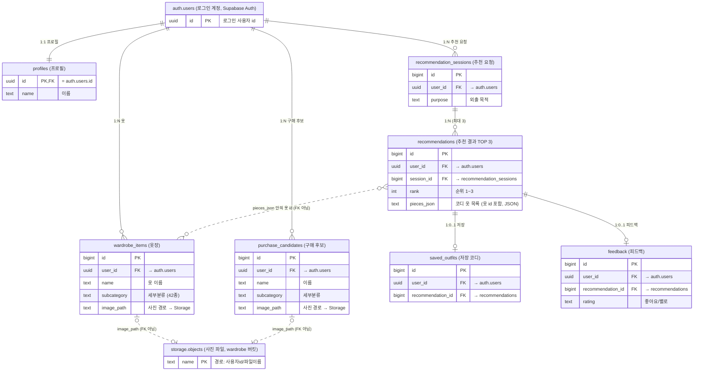

# 기술설계서 — AI 옷장

작성 기준: 2026-11-07 (추천 규칙 v2, 화면 분리, 성능 개선 반영), 처음 작성 2026-10-20. 기능 기준은 `docs/prd.md`, 배포 절차는 `DEPLOY.md`, 분류기 평가 조건은 `docs/evaluation.md`.

## 1. 기술 스택

| 영역 | 사용 기술 | 버전 |
|---|---|---|
| 앱 화면·서버 | Python, Streamlit | Python 3.12 (배포), Streamlit 1.66.0 |
| 로그인·DB·파일 | Supabase (Auth, PostgreSQL + RLS, Storage), supabase-py | supabase 2.33.0 |
| 옷 분류 AI | PyTorch, torchvision (EfficientNet-B0) | torch 2.9.1 CPU, torchvision 0.24.1 CPU |
| 데이터 처리 | pandas, numpy, Pillow | requirements.txt 범위 |
| 날씨 | Open-Meteo API (requests) | – |
| 가상 착용 | Hugging Face ZeroGPU Space, Gradio, spaces, diffusers, transformers, CatVTON | Gradio 5.49.1, diffusers 0.41.0, transformers 5.19.0, CatVTON 커밋 7818397 |
| 웹 체험판 | 순수 HTML·JavaScript (라이브러리 없음) | – |
| 로컬 모드 | SQLite, 로컬 폴더 `data/uploads/` | – |
| 시험 | pytest, Streamlit AppTest, Node.js(웹-앱 결과 비교) | – |

## 2. 시스템 구조

```
[사용자 브라우저]
   │ https
   ▼
[Streamlit Community Cloud]  app.py (설정·로그인·메뉴) + screens/ (화면) + core/
   ├─ core/vision.py        옷 분류(EfficientNet-B0, CPU) · 대표색
   ├─ core/eligibility.py   온도 세 가지 · 후보 자격 · 젖음 부담
   ├─ core/recommender.py   추천 단계·점수·순위
   ├─ core/shopping.py      구매 판정
   ├─ core/weather.py ──────► Open-Meteo API
   ├─ core/cloud_auth.py ───► Supabase Auth (이메일 로그인)
   ├─ core/cloud_store.py ──► Supabase PostgreSQL (RLS)
   └─ core/media.py ────────► Supabase Storage (비공개 버킷 wardrobe)
                                   │ 10분짜리 서명 주소
[가상 착용 버튼] ──새 창/앱 안 창──► [Hugging Face ZeroGPU Space] tryon_space/app.py (CatVTON)

[GitHub Pages] web/ ── 설치 없는 웹 체험판 (서버 없음)
```

## 3. 코드 구조

| 경로 | 역할 |
|---|---|
| `app.py` | 설정 읽기, 저장소 선택(로컬/클라우드), 사이드바, 메뉴 → 화면 연결 (약 100줄) |
| `screens/context.py` | 한 번 그릴 때 쓰는 `App`: 저장소·사진 저장소·설정, 그번에만 쓰는 캐시(사용자 1번·옷장 1번 읽기), 목록용 작은 사진. 저장소를 감싸 옷장·체질을 바꾸는 함수(`WARDROBE_CHANGES`)가 성공하면 지난 추천을 비운다. 세션마다 다른 값은 모듈 전역에 두지 않는다 (사용자끼리 섞임 방지) |
| `screens/*.py` | 화면마다 하나: `login`, `home`, `profile`, `wardrobe`, `direct_add`, `recommend`, `shopping`, `saved`, `kpi`, 공통 위젯 `common` (가상 착용 창·정보 수정 창·AI 후보 고르기) |
| `core/config.py` | 설정 읽기(환경 변수 → Streamlit Secrets), 서비스 키 거부, Supabase 주소 정리 |
| `core/cloud_auth.py` | 가입·로그인·세션·로그아웃, 오류 문구 변환 |
| `core/db.py` / `core/cloud_store.py` | 같은 함수 이름의 두 저장소: SQLite / Supabase. 화면 코드는 `store.함수()`만 부른다. 여러 벌 한 번에 넣기 `create_wardrobe_items`(Supabase는 insert 1번), 저장 후 고치기 `update_wardrobe_item`(지운 옷 제외) |
| `core/media.py` | 사진 저장: `LocalMedia`(폴더) / `SupabaseMedia`(Storage, 서명 주소). `PhotoCache`(최근 쓴 순서, 크기 한도)를 세션에 두어 다시 그릴 때 사진을 다시 내려받지 않음, 목록용 작은 사진 `thumbnail_jpeg` |
| `core/batch_add.py` | 직접 추가(사진 여러 장) 계산: 10장 제한, 끝과 처음이 이어진 이동, 다음 확인 안 한 사진, 겹치지 않는 자동 이름. 화면 상태(확인 카드)는 `st.session_state.ba_cards`에 두고, 안 보이는 카드의 입력값은 카드에 따로 보관한다 (Streamlit은 화면에 없는 위젯 값을 지움) |
| `core/eligibility.py` | 온도 세 가지(실제 체감·추천 기준·두께 취향), 옷 하나의 후보 자격(절대 금지 / 목적 완화 / 기온 완화), 젖음 부담(사용자 체크 우선). 추천·구매 판정이 같이 쓰고, 계절 계산도 같은 기온 비교를 씀 |
| `core/recommender.py`, `core/taxonomy.py`, `data/clothing_taxonomy.csv` | 추천 단계(정상 → 목적 완화 → 기온 완화 → 둘 다, 코디가 나오는 첫 단계), 점수·순위(0.02 칸 → 색 → 점수 → FNV-1a 고정 순서), 42종 규칙표(착용 범위, 절대 금지·완화 목적, 젖음 부담, 비를 막는 겉옷), 겹쳐 입기·평소 피하는 조합, 계절 계산 |
| `core/shopping.py` | 사기 전에 맞춰보기 |
| `core/vision.py` | 분류 모델 불러오기·분류, 대표색 |
| `core/weather.py` | Open-Meteo 호출, 귀가 전 최저 기온 |
| `core/colors.py`, `core/care.py`, `core/catalog.py` | 색 이름·조화, 세탁 가이드, 스타터 옷장 |
| `core/tryon.py` | 가상 착용 옷 고르기, Space 주소 만들기 |
| `supabase/schema.sql` | 표·접근 정책·사진 버킷 (여러 번 실행해도 안전) |
| `tryon_space/` | Hugging Face Space에 올리는 가상 착용 앱. 옷 사진 주소가 다른 곳으로 넘어가면 넘어갈 때마다 허용 목록을 다시 확인(최대 3번) |
| `scripts/` | 데이터 받기·학습(`open_datasets.py`, `prepare_dataset.py`, `train_classifier.py`), 웹 체험판 만들기(`build_web.py`), Supabase 점검·이전 |
| `web/` | 웹 체험판 (`src/closet.js` 추천 규칙·후보 자격, `src/closetnet.js` 분류 모델 계산). 규칙 숫자는 `build_web.py`가 파이썬 소스에서 뽑아 넣는다 |
| `tests/` | 자동 시험 (`docs/test-plan.md`) |

## 4. 데이터베이스 (Supabase PostgreSQL)

| 표 | 주요 열 | 제약 |
|---|---|---|
| `profiles` | id(=로그인 사용자), name, gender, cold_sensitivity, heat_sensitivity | id → auth.users, 계정당 1행 |
| `wardrobe_items` | user_id, name, category, subcategory, color, warmth, rain_ok, material, image_path, ai_category/ai_subcategory/ai_confidence, seasons, active, deleted | 삭제는 deleted=1 (소프트 삭제) |
| `recommendation_sessions` | user_id, purpose, temperature, apparent_temperature, humidity, precipitation, rain, wind_speed, weather_source, started_at, completed_at | 추천 1회 = 1세션 |
| `recommendations` | user_id, session_id, rank, score, pieces_json, reasons_json, components_json | 세션당 TOP 3 |
| `saved_outfits` | user_id, recommendation_id, saved_at | unique(user_id, recommendation_id) |
| `feedback` | user_id, recommendation_id, rating(like/dislike), worn, thermal_feedback(−2~2), satisfaction(1~5) | unique(user_id, recommendation_id) |
| `purchase_candidates` | user_id, name, category, subcategory, color, warmth, rain_ok, image_path, link, deleted | – |

- 모든 표의 `user_id`는 기본값 `auth.uid()`, auth.users 삭제 시 함께 삭제(cascade).
- 시각은 한국 시간 ISO 문자열(text)로 저장해 로컬 SQLite 형식과 맞춘다.
- 사진 참조: 로컬은 파일 경로, 클라우드는 `sb:<사용자id>/<파일명>.jpg`.

### 관계 (ER 다이어그램)



- 실선 = 외래키(FK), 점선 = 값으로만 연결(FK 아님). 모든 표의 `user_id` → auth.users 선은 그림을 단순하게 하려고 생략했다.
- auth.users ─ profiles **1:1**, auth.users ─ wardrobe_items·purchase_candidates·recommendation_sessions **1:N**, 세션 ─ recommendations **1:N(최대 3)**, recommendations ─ saved_outfits·feedback **1:0..1** (고유 제약).
- recommendations ↔ wardrobe_items 는 FK가 아니라 `pieces_json` 안의 옷 id(추천 당시 옷 정보 그대로)로 연결한다. 옷을 지워도(소프트 삭제) 저장 코디가 깨지지 않게 하려는 것이고, 대신 DB가 연결을 보장하지는 않는다.
- 사진 파일은 비공개 Storage `wardrobe` 버킷에 "사용자id/파일이름"으로 두고 표에는 경로만 둔다.
- 로컬 SQLite(`core/db.py`)는 같은 구조이고, auth.users·profiles 대신 `users` 표 하나(정수 id)를 쓴다.

## 5. 인증·인가·보안

| 항목 | 설계 |
|---|---|
| 로그인 | Supabase Auth 이메일+비밀번호. 브라우저 세션마다 클라이언트 1개(`st.session_state`)를 두어 사용자끼리 섞이지 않게 함. 만료 토큰은 자동 갱신. 사진 캐시도 세션에 두고, 경로의 사용자 id가 본인일 때만 읽음 |
| 표 접근 | 모든 표 RLS 켬. 정책: `user_id = auth.uid()`. 하위 표(추천·저장·피드백)는 부모 행도 본인 것인지 추가 확인. 비로그인(anon) 역할은 표 권한 없음 |
| 사진 | 비공개 버킷 `wardrobe`, 파일당 5MB, jpg/png/webp. 첫 폴더가 본인 id인 경로만 읽기·쓰기·삭제 |
| 키 | 앱에는 공개 키(publishable)만. service_role/secret 키가 들어오면 실행 거부. 예전 anon 키(2026년 말까지 폐지 예정)는 받아 주되 서버 기록에 바꾸라는 경고 |
| 비밀 설정 | Streamlit Secrets / Hugging Face Space Variables에만 둔다. 저장소에는 `.streamlit/secrets.toml.example`만 있고 실제 파일은 `.gitignore` |
| 가상 착용 | 옷 사진은 10분짜리 서명 주소로만 전달. Space는 허용 호스트(`ALLOWED_GARMENT_HOSTS`)의 https 주소만 받고, 다른 주소로 넘기는 응답(리다이렉트)은 저절로 따라가지 않고 넘어갈 때마다 허용 목록을 다시 확인 (최대 3번). 사람 사진은 AI 옷장에 저장하지 않고, Space 임시 파일은 1시간이 지나면 정리 |
| 업로드 | Streamlit 업로드 최대 20MB, 저장 전 긴 변 1280px JPEG로 줄임 (사진 방향 보정 포함) |

## 6. 외부 API

| API | 호출 | 쓰는 값 |
|---|---|---|
| Open-Meteo `GET https://api.open-meteo.com/v1/forecast` | 위도·경도, `current`, `hourly`, `forecast_days=2`, `timezone=auto` | 기온, 체감온도, 습도, 강수, 비, 풍속 / 시간별 기온·체감온도 |
| Supabase Auth | `sign_up`, `sign_in_with_password`, `get_session`, `sign_out` | 로그인 사용자 |
| Supabase PostgREST | 표 조회·추가·수정·upsert | 4절 표 |
| Supabase Storage | upload, download, create_signed_url, remove | 옷 사진 |
| Hugging Face Space | 주소 쿼리 `?garment=…&kind=upper&garment2=…&kind2=lower` | Space가 옷 사진을 미리 채움 |

## 7. AI 구성

### 옷 분류 모델 (직접 학습)
- EfficientNet-B0(ImageNet 사전학습) + Dropout 0.3 + Linear 1280→42. 약 406만 파라미터.
- 학습: 마지막 2개 블록과 분류층만 재학습, AdamW, 클래스 가중치 1/√장수, label smoothing 0.1, 15 에폭. 증강은 좌우 반전본 + 무작위 변형본 1벌(90·180·270도 회전, ±20도 기울기, 자르기, 밝기·색, 흐림, `--aug-copies 1`).
- 데이터 37,753장 = 학습 32,626 + 검증 5,127. 종류별 최소 400장(플리스 407, 야상 415, 나머지 600장 이상). 검증 정확도 83.3%, 클래스 평균 81.7%.
- 사진이 적던 13종 보충 2,645장(`data/extra_weak_classes.csv`, 출처 `extra`)은 학습에만 넣어 검증은 이전 모델과 같은 사진으로 비교한다.
- 휴대폰 사진 시험 192장 (학습·검증에 안 씀, `data/grigorev_relabel.csv`의 `split=test`): 앱과 같은 원본 입력 **63.5%**, 상위 3개 88.5%, 대분류 92.2%. JPEG 품질 92로 다시 저장한 사진(예전 기록의 조건)은 65.1%. 90·180·270도 돌아간 사진은 45~49% (품질 92 조건). 조건과 과거 모델 비교는 `docs/evaluation.md`. 검증 정확도는 학습용으로 가공한 검증 사진 기준이고, 웹 체험판 정확도는 따로 재지 않았다.
- 추론: 224×224, ImageNet 정규화, softmax → 상위 3개 후보(세부분류·대분류·확신도)와 1등 확신이 70%(`core/vision.py`의 `SURE_CONFIDENCE`, 웹 체험판과 같음) 이상인지. 대분류는 규칙표로 정한다.
- 파일: `models/clothing_classifier.pt`. 웹 체험판은 fp16 가중치(배치정규화를 conv에 합침)를 순수 JS로 계산.

### 가상 착용 (외부 공개 모델, 학습 안 함)
- CatVTON (Stable Diffusion 1.5 인페인팅 기반, CC BY-NC-SA 4.0).
- 처리: 옷 사진 받기 → DensePose·SCHP로 입힐 영역 마스크 → 사람 없음 검사 → CatVTON 생성 → 안전 필터 → 결과.
- 기본 768×1024, 단계 20/30/50. 2벌이면 상의→하의 순서로 두 번.
- ZeroGPU: `@spaces.GPU(duration=…)`로 요청 때만 GPU 사용. 예약 시간은 단계 수 × `TRYON_SEC_PER_STEP`(기본 1.0초) + 20초, 최대 120초.

## 8. 설정값

| 위치 | 이름 | 설명 |
|---|---|---|
| Streamlit Secrets | `SUPABASE_URL` | 프로젝트 주소 (대시보드 주소를 넣어도 자동 변환) |
| 〃 | `SUPABASE_KEY` | 공개 키 |
| 〃 | `TRYON_SPACE_URL` | (선택) 가상 착용 Space 페이지 주소 |
| 〃 | `WEB_TRIAL_URL` | (선택) 웹 체험판 주소 |
| Space Variables | `ALLOWED_GARMENT_HOSTS`, `TRYON_SEC_PER_STEP`, `TRYON_SIZE` | 허용 호스트, GPU 예약 계산값, 처리 해상도 |

`SUPABASE_URL`·`SUPABASE_KEY`가 없으면 로컬 모드(로그인 없음, SQLite)로 동작한다.

## 9. 배포

| 대상 | 방식 |
|---|---|
| 앱 | Streamlit Community Cloud, GitHub `main` / `app.py`, Python 3.12. `main`에 push하면 자동 재배포. 리눅스에서는 CPU 전용 PyTorch 휠을 직접 받는다 (`requirements.txt`) |
| DB·로그인·사진 | Supabase 프로젝트에 `supabase/schema.sql` 실행, 이메일 인증 끔 |
| 가상 착용 | Hugging Face ZeroGPU Space에 `tryon_space/` 파일 3개 업로드 |
| 웹 체험판 | GitHub Actions `.github/workflows/pages.yml` → GitHub Pages (`web/` 변경 시 자동, 처음은 수동 실행) |

무료 한도·잠들기·사용량 제한은 `DEPLOY.md` 5절.

## 10. 알려진 기술 과제

- 화면을 다시 그릴 때 Supabase 호출을 줄였다 (내 옷장: DB 6번 + 사진 30장 → DB 2번 + 사진 0장, 요청마다 지연을 넣은 가짜 Supabase에서 6.9초 → 0.4초). 배포 주소에서는 화면 전환 약 1초, 사진 저장 1.2초, 추천 1.7초 (2026-11-07, 11-02에는 옷 저장 후 목록 12.2초). 서버가 깨어난 직후의 첫 AI 분류 시간은 재지 않았다.
- '샀어요'는 SQLite에서는 한 거래로 처리하지만, Supabase(REST)는 여러 요청을 한 거래로 묶을 수 없어 후보를 먼저 빼는 데 성공한 요청만 옷장에 넣고 실패하면 되돌린다. 되돌리기까지 실패하면 후보가 빠진 채 남을 수 있다 (옷이 두 벌 들어가는 것보다 낫다고 봄).
- 추천 점수의 실험값(날씨 0.7 / 젖음 0.3, 신발 0.5 / 하의 0.3 / 겉옷 0.2)은 사용자 시험 결과로 다시 정한다.
- 앱 안 창(`*.hf.space`)에서는 Hugging Face 방문자 확인 정보가 전달되지 않아 ZeroGPU 사용량이 방문자 각자 기준인지 확인되지 않았다. 앱은 새 창을 권장한다.
